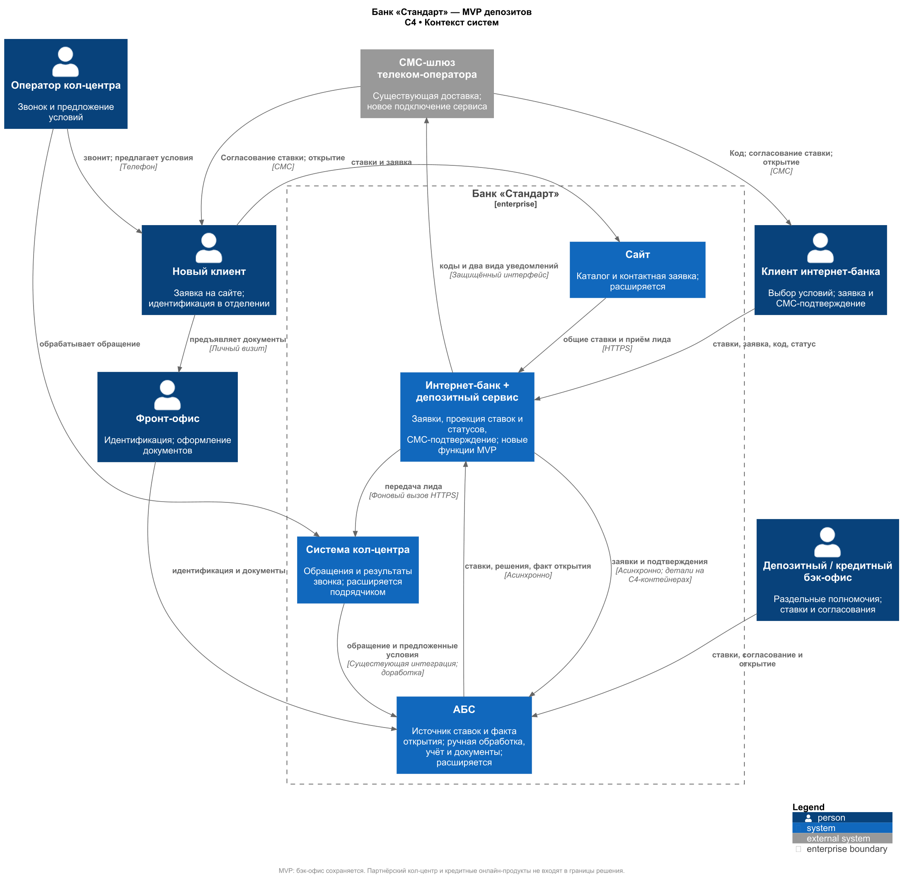
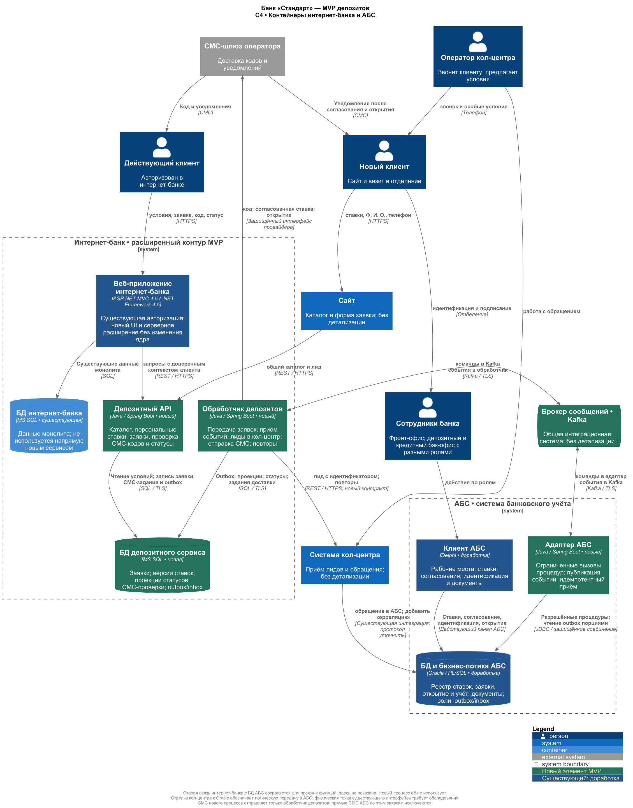

### **Название задачи:** Схема концептуальной архитектуры открытия депозитов
### **Автор:** Самсонво Александр
### **Дата:** 01.11.2026
### **Функциональные требования**

|   **№**   | **Действующие лица или системы** | **Use Case** | **Описание** |
|:---------:| :- | :- | :- |
|        | Бэк-офис; АБС; сайт; интернет-банк | Актуальные ставки | 1. Сотрудники ведут ставки централизованно в АБС. 2. Сайт и интернет-банк показывают общие ставки; интернет-банк дополнительно показывает персональные предложения клиента. |
|     | Новый клиент; сайт; кол-центр; фронт-офис | Заявка с сайта и идентификация | 1. Клиент оставляет Ф. И. О. и телефон. 2. Заявка поступает в кол-центр; оператор звонит и предлагает условия. 3. Новый клиент проходит идентификацию и оформляет документы в отделении. |
|   | Клиент; интернет-банк; бэк-офис; АБС; СМС-шлюз | Подтверждение заявки и открытие | 1. Клиент интернет-банка выбирает счёт и сумму и подтверждает заявку СМС-кодом. 2. Заявки обоих каналов обрабатывает бэк-офис: согласует условия и открывает депозит в АБС после необходимых проверок и оформления. 3. Клиент получает СМС после согласования ставки и после открытия. |

### **Нефункциональные требования**

| **№** | **Требование** |
| :-: | :- |
| 1 | **Надёжность.** Работа 24/7 с доступностью не ниже 99,9% и восстановлением в резервном ЦОД. Период измерения, RTO и RPO необходимо согласовать. |
| 2 | **Производительность.** Быстрый отклик онлайн-операций без перегрузки АБС: асинхронная обработка и горизонтальное масштабирование онлайн-компонентов. Числовые пороги отклика уточняются; новый процесс не обращается из интернет-банка напрямую к АБС. |
| 3 | **Безопасность.** Шифрование чувствительных данных при передаче, проверка доступа клиента и сохранение разграничения полномочий депозитного и кредитного бэк-офиса. |
### **Решение**

Выделить депозитный функционал в новый сервис внутри границы интернет-банка, доступный также серверу сайта. Сохранить существующий монолит для аутентификации, текущих функций и нового экрана депозитов. АБС остаётся источником истины по утверждённым ставкам, решениям менеджера и факту открытия. Новый сервис владеет онлайн-заявкой до передачи в АБС и хранит проекцию её дальнейшего состояния; он не ведёт банковский учёт и не открывает депозит самостоятельно.

Использовать Java / Spring Boot для депозитного API, фонового обработчика и адаптера АБС: в банке есть соответствующий опыт, а новый runtime не наследует несовместимость старой платформы с Kafka. MS SQL выбрать для отдельной БД депозитного сервиса. Это отдельное хранилище с отдельными правами и ресурсами, а не новые таблицы в БД старого интернет-банка. Конкретные версии Java, Spring, драйверов и Kafka выбрать после проверки совместимости и поддержки. Назначение Java-разработчиков на новый сервис требует выделения мощности команды; наличие нескольких специалистов не гарантирует свободных ресурсов.

Kafka использовать только для развязки сервиса депозитов и АБС: заявки/подтверждения идут в одну сторону, опубликованные ставки и статусы — в другую. Синхронные REST/HTTPS-вызовы от сайта и расширения интернет-банка заканчиваются на депозитном API. Пользовательский запрос не ждёт ни обработки Kafka, ни ответа АБС. Для передачи лидов в кол-центр фоновый обработчик использует защищённый API системы кол-центра: банк не предполагает, что эта система уже поддерживает Kafka.

### **Альтернативы**
 Альтернатива | Почему не выбрана базовой |
| --- | --- |
| Доработать только монолит и синхронно обращаться к API или БД АБС | Быстрее использовать привычную связь, но онлайн-нагрузка и отказы АБС попадут в клиентский сценарий; противоречит изоляции АБС. |
| Встроить новые функции и СМС в ядро подрядчика | Возможен повторный вызов готового механизма, но возникает зависимость от доработки ядра. Рассматривается как резервный вариант при невозможности безопасного внешнего подключения. |
| Только REST между отдельным сервисом и АБС с собственной очередью в SQL | Меньше новой инфраструктуры. Возможная альтернатива, если сопровождение Kafka недоступно, однако требует собственной надёжной доставки и не использует предпочтительный для развития брокер. Нельзя превращать её в синхронную цепочку из клиентского запроса. |
| Прямая Kafka-интеграция старого интернет-банка | Противоречит указанной несовместимости платформы; новый обработчик изолирует её от Kafka. |
| Полная миграция интернет-банка на микросервисы и active-active двух ЦОД | Существенно расширяет MVP и риски работы с состоянием. Отдельный депозитный сервис и подготовленный резерв решают ограниченную задачу без такой миграции. |
| Продолжать считать XLS главным реестром ставок | Не обеспечивает управляемую актуальность онлайн-каталога, версии и разграничение совместной работы; допустим только контролируемый начальный импорт. |

**Недостатки, ограничения, риски**

1. **Ограниченная производительность АБС и бэк-офиса.** Очередь сглаживает пики, но не ускоряет работу Oracle и сотрудников: заявки могут накапливаться. Необходимо ограничивать нагрузку и контролировать время обработки.
2. **Доступность 99,9% пока не обеспечена.** Требуются подготовка резервного ЦОД, согласование сроков восстановления и проверка переключения под нагрузкой.
3. **Зависимость от интеграций и правил оформления.** Нужно проверить подключение СМС и кол-центра без изменения ядра интернет-банка, а также уточнить дистанционное оформление договора. Эти зависимости могут увеличить сроки и стоимость MVP.
