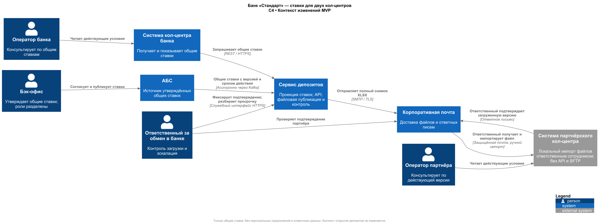
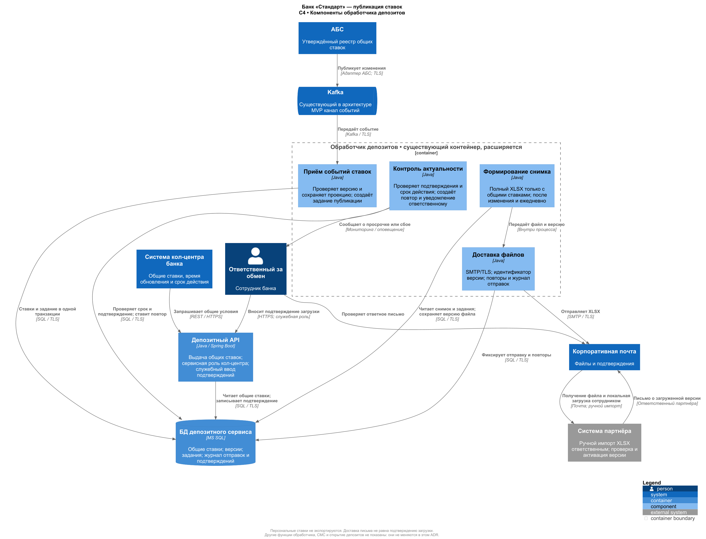

### **Название задачи:** Актуальные ставки для собственного и партнёрского кол-центров в MVP депозитов.
### **Автор:** Самсонов Александр
### **Дата:** 01.11.2026
### **Функциональные требования**

| № | Действующие лица или системы | Use Case | Описание |
| :-: | --- | --- | --- |
| 1 | Бэк-офис, АБС, сервис депозитов | Публикация ставок | 1. Сотрудники согласуют общие ставки в АБС. 2. Изменения поступают через Kafka в проекцию сервиса депозитов. 3. Оба кол-центра получают одну утверждённую версию. |
| 2 | Оператор банка, система кол-центра | Консультация клиента | 1. Система получает общие ставки через депозитный API. 2. Оператор видит условия, версию и срок действия и консультирует клиента. |
| 3 | Обработчик депозитов, почта, система и оператор партнёра | Файловое обновление | 1. Банк отправляет файл общих ставок. 2. Ответственный партнёра загружает файл в свою систему и подтверждает версию ответным письмом. 3. Операторы консультируют по загруженным условиям; просроченная версия не используется. |
### **Нефункциональные требования**

| № | Требование |
| :-: | --- |
| 1 | **Актуальность:** передавать ставки после каждого утверждённого изменения и выполнять ежедневную контрольную отправку; контролировать версию, срок действия, доставку и загрузку. Допустимую задержку согласовать с бизнесом и партнёром. |
| 2 | **Безопасность:** передавать только общие ставки и условия, без данных клиентов, персональных предложений и исходных кредитных данных; защищать канал и проверять отправителя. |
| 3 | **Надёжность:** не создавать онлайн-нагрузку на АБС; сохранять задания доставки и повторять неуспешные отправки. Существующая цель доступности сервиса депозитов — 99,9%; актуальность внешней загрузки контролируется отдельно. |
### **Решение**

**Кол-центр банка** получает общие ставки из существующего депозитного API по HTTPS, с отдельной сервисной ролью. Прямой доступ к Oracle и персональным предложениям не предоставляется. В интерфейсе отображаются время обновления и срок действия; при недоступности можно показывать сохранённую версию только пока она действительна.

**Партнёру — XLSX через корпоративную почту**, без API и SFTP. Это развитие текущего файлового процесса банка. Новые компоненты существующего обработчика депозитов формируют полный снимок общих ставок, отправляют его через SMTP/TLS и учитывают подтверждения. Ответственный партнёра импортирует файл локально и отвечает письмом с номером загруженной версии; сотрудник банка фиксирует подтверждение в служебном интерфейсе. Почтовая квитанция сама по себе не означает загрузку в систему партнёра.

Файл содержит версию, время формирования, период действия, код продукта, валюту, срок, минимальную сумму, ставку и условия её применения. Будущие ставки не активируются раньше срока. Проверяются структура, версия и целостность; файл загружается целиком, старая версия не заменяет новую. Защита почтового канала и проверка отправителя, включая согласованный механизм подписанных писем, — условие подключения партнёра.

При отсутствии подтверждения или истечении срока версии банк получает уведомление, повторяет доставку и связывается с ответственным партнёра. Просроченную ставку оператор не обещает клиенту; обращение переводится в банк. Партнёр только консультирует по общим условиям: не согласует персональные ставки и не открывает депозит.

Для новых компонентов используются **Java / Spring Boot и MS SQL** существующего депозитного сервиса. Отдельный микросервис или новая СУБД не вводятся. Перераспределение звонков, обучение и достаточное число операторов — отдельные обязательные работы перед маркетинговым запуском: передача файла сама по себе перегрузку не устраняет.

### **Альтернативы**
| Альтернатива | Причина отказа |
| --- | --- |
| Прямой доступ кол-центров к АБС | Дополнительная нагрузка и расширение доступа к банковским данным. |
| API или SFTP для партнёра | Не используются из-за ограничения задания; транспорт файлов выбран через почту. |
| Постоянная ручная рассылка исходных XLS | Допустима как временный процесс, но создаёт независимые версии и не обеспечивает контроль актуальности к запуску MVP. |

**Недостатки, ограничения, риски**

1. **Задержка файлового обновления.** Почта и ручной импорт не обеспечивают мгновенную актуальность; нужны срок действия, подтверждение загрузки и эскалация.
2. **Зависимость от партнёра.** Формат, защищённую почту, импорт и запрет просроченных версий необходимо проверить до запуска.
3. **Риск перегрузки сохраняется.** Требуются маршрутизация звонков, обучение и проверка пропускной способности обоих кол-центров до маркетинговой кампании.

